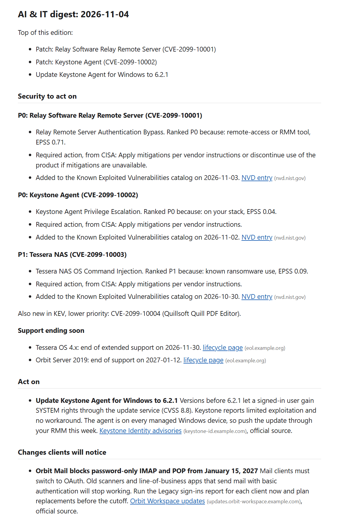
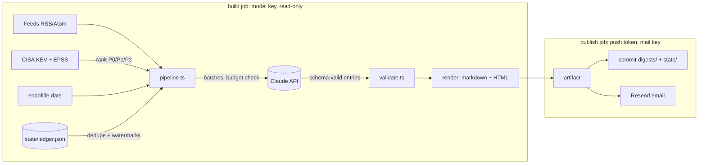

# AI & IT News Digest

A twice-weekly email for a small IT team: what to patch, what clients will notice, and what is worth offering. It reads vendor feeds and the CISA Known Exploited Vulnerabilities catalog on a GitHub Actions schedule, has Claude summarize the news, checks every summary against its source in code, and commits the digest to the repo.



> The screenshot and [`examples/sample-digest.md`](examples/sample-digest.md) are generated from made-up fixture data (fictional vendors, `example.com` links, CVE IDs in the 2099 range) by `npm run demo`. No API key is needed for the demo.

## Why it exists

An IT team that supports dozens of small businesses has to track Microsoft and Google changes, security advisories, price changes, AI product launches and new regulations. Nobody has time to read forty feeds, and an AI summary of forty feeds is only useful if you can trust it. This keeps the model on a short leash: it reads and rewords, while code decides what is urgent, where links point, and whether a fact is allowed into the email.

## What a run does

1. **Fetch** RSS/Atom feeds, CISA KEV (with FIRST EPSS scores) and endoflife.date support dates. Each source has a watermark and every item has a stable ID in a JSON ledger, so nothing is reported twice. A failing feed is listed under "Run health" and the rest of the run carries on.
2. **Rank security in code.** A KEV entry is P0 if it is on your stack or is a remote-access/RMM tool (one bug there reaches every client), P1 for known ransomware use or EPSS of 0.1 or more, P2 otherwise. The model never decides what is urgent.
3. **Summarize** news items in batches with Claude (`claude-sonnet-5-5` by default) using [structured outputs](https://platform.claude.com/docs/en/build-with-claude/structured-outputs) and a Zod schema. Each item comes back classified as act on, client-facing change, worth offering, good to know, or skip.
4. **Validate** every entry against the item it describes (see the table below), then render markdown and email-safe HTML.
5. **Publish** in a separate job: commit the digest and ledger, and optionally email it through Resend.

## Risks this handles

| Risk | What the code does |
|---|---|
| A feed contains instructions for the model ("ignore previous instructions...") | Item text is escaped and wrapped as data, so it cannot close its own element; the system prompt says items are untrusted. The model has no tools, and its output is a fixed schema. |
| The model invents a link | The model never returns URLs. Links come from the fetched item, only `https` survives, and URLs or markdown in model text are stripped. The email shows each link's host next to it. |
| The model invents a fact | Every version, price, percentage, date and count in a summary must appear in the source item. If not, the summary is dropped and the item is listed under "Held back for review" with its original link. |
| A rumor reads like news | The trust label comes from the source's tier in config, not from the model. An "act on" or "change" item from an aggregator moves to "Good to know", marked unconfirmed. |
| A preview gets pitched to clients | "Worth offering" needs an official source and a generally available feature. Previews are moved down with a note. |
| A surprise API bill | Each batch is checked against a monthly cap at its worst-case cost (prompt size plus the full output allowance) before it is sent, and recorded at real cost after. Over the cap, items wait for the next run. A model without a price in `src/budget.ts` refuses to start. |
| Refusals and truncation | `stop_reason` is checked before any output is used. Truncated batches retry next run; refused items are listed for a human instead of being retried forever. |
| A crashed run loses items | Ledger changes are applied only after the digest file is written. Items deferred by the budget or the per-run cap hold their feed's watermark back, so they are still new next time. |
| HTML or tracking pixels in the email | Raw HTML in the markdown is escaped, images are dropped, and the send step refuses any HTML with scripts, event handlers or non-https links. |
| Secrets in the wrong place | The job that runs the model has a read-only token and no mail key. The job that pushes and sends never sees the model key and copies back only the digest, `ledger.json` and `budget.json` from the build artifact. Keys live in Actions secrets, never in files. |

## Architecture



| Path | Responsibility |
|---|---|
| `src/sources/` | Feed parsing and windowing, KEV ranking, end-of-life dates |
| `src/llm/summarize.ts` | Prompt, batching, the Claude call (`messages.parse` + `zodOutputFormat`), budget checks |
| `src/llm/validate.ts` | Fact check against the source, link stripping, section and trust rules |
| `src/render/` | Markdown digest, email HTML, subject line |
| `src/ledger.ts`, `src/budget.ts` | Dedupe state and the monthly spend cap, both committed as JSON |
| `src/pipeline.ts` | Runs the steps and returns the digest plus the ledger changes to apply |
| `src/demo.ts` | Fixture HTTP and a scripted model for the demo and tests |
| `config/sources.json` | Feeds, tiers, your stack and remote-access tools, products to watch |

## Run it

Requires Node 22 or later.

```bash
npm install
npm run demo                 # fixture data, scripted model, writes examples/
```

Against real sources:

```bash
cp .env.example .env         # set ANTHROPIC_API_KEY, then export the values
npm run digest               # writes digests/<date>.md and updates state/
npm run digest -- send digests/2026-11-04.md   # needs RESEND_API_KEY and DIGEST_TO
```

Edit `config/sources.json` first: the `audience` line, your feeds and their tiers, `kev.stack` (vendors you support) and `kev.remoteAccessTools`.

### GitHub Actions

`.github/workflows/digest.yml` runs Sundays and Wednesdays at 12:00 UTC.

| Setting | Type | Purpose |
|---|---|---|
| `ANTHROPIC_API_KEY` | secret | Claude API key, used only by the build job |
| `RESEND_API_KEY` | secret | Mail key, used only by the publish job |
| `DIGEST_ENABLED` | variable | `true` turns on the schedule |
| `SEND_EMAIL` | variable | `true` emails scheduled runs |
| `DIGEST_TO`, `DIGEST_FROM` | variables | Recipient and sender |
| `CLAUDE_MODEL`, `MONTHLY_BUDGET_USD` | variables | Optional; default `claude-sonnet-5-5` and `5` |

Use **Actions > Digest > Run workflow** to test; leave "send email" unchecked and the digest is committed and uploaded as an artifact.

## Tests

```bash
npm test           # 77 tests, no network calls, no API key
npm run typecheck
```

The model and HTTP are replaced by fakes, so the suite is offline and free. It covers feed parsing, watermarks and caps, KEV ranking, the fact check, prompt-injection escaping, budget deferral, ledger behavior across runs, HTML sanitizing, and that `npm run demo` reproduces the committed sample digest exactly. CI also runs [gitleaks](https://github.com/gitleaks/gitleaks) over the full history on every push.

## How this was built

I built this with Claude Code, Anthropic's AI coding assistant, the same way I build automations for clients: I set the design, the safety rules and the test cases, the assistant drafted code against them, and nothing went in without passing the test suite and my review. I'm responsible for every line.

It is a clean-room version of a news digest I run for my own work in managed IT. No code, client names, internal addresses or data from that project are included.

## License

MIT
